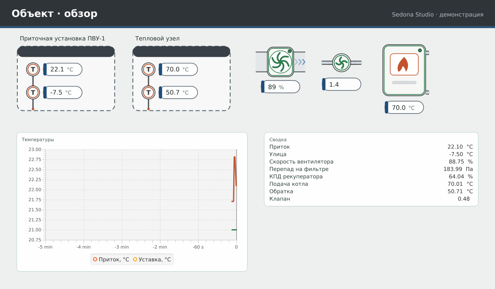

# SedonaPro

### Open automation. Visual engineering. Real hardware.

A community for people who enjoy building with Sedona: control engineers,
embedded developers, electronics makers and curious learners.

We are bringing together a compatible runtime, visual editors, ESP32 firmware
and practical control examples. Start on a computer, understand the diagram,
then take the same ideas to hardware.

## Find your project

| Project | Focus |
| --- | --- |
| SedonaPro Runtime | VM, kits, SDK, build tooling and simulation |
| Sedona Studio for Linux | Linux desktop editor and operator screens |
| Sedona Studio for Windows | Windows desktop editor and native-kit workshop |
| Sedona for ESP32-S3 | ESP32-S3 firmware and board support |
| Sedona for ESP32-P4 | ESP32-P4 controller firmware and Ethernet hardware |

**Launch status:** the source repositories are being prepared privately.
Public source links, build instructions, verified screenshots and releases will
be added as each project completes its publication review. Linux and Windows
editors are separate projects; ESP32-S3 and ESP32-P4 firmware are separate too.

## A look inside

An existing Linux Studio demo: air handling and heating overview, live indicators
and a short trend. Demo labels are in Russian. This is a software demonstration,
not a photograph or an electrical acceptance test.

## Join in

- [Introduce yourself or ask a question](https://github.com/SedonaPro/.github/discussions).
- Share a control diagram, a simulator experiment or a board you are building.
- Help with firmware, editor usability, documentation or translations.
- Reproduce a problem and contribute a small, testable improvement.

English is the reference language for documentation and contributions.
Questions in Russian are welcome; a short English summary helps everyone join in.

## How we work

We prefer reproducible examples, clear compatibility information and honest
test reports. A simulator result is not a hardware test. Every hardware project
will document what board, SDK, firmware and I/O have actually been tested.

See our [contribution guide](https://github.com/SedonaPro/.github/blob/main/CONTRIBUTING.md),
[community guidelines](https://github.com/SedonaPro/.github/blob/main/CODE_OF_CONDUCT.md)
and [support guide](https://github.com/SedonaPro/.github/blob/main/SUPPORT.md).

SedonaPro is an independent community project, not affiliated with or endorsed
by Tridium. Upstream attribution and component licences are retained in each
source project.
